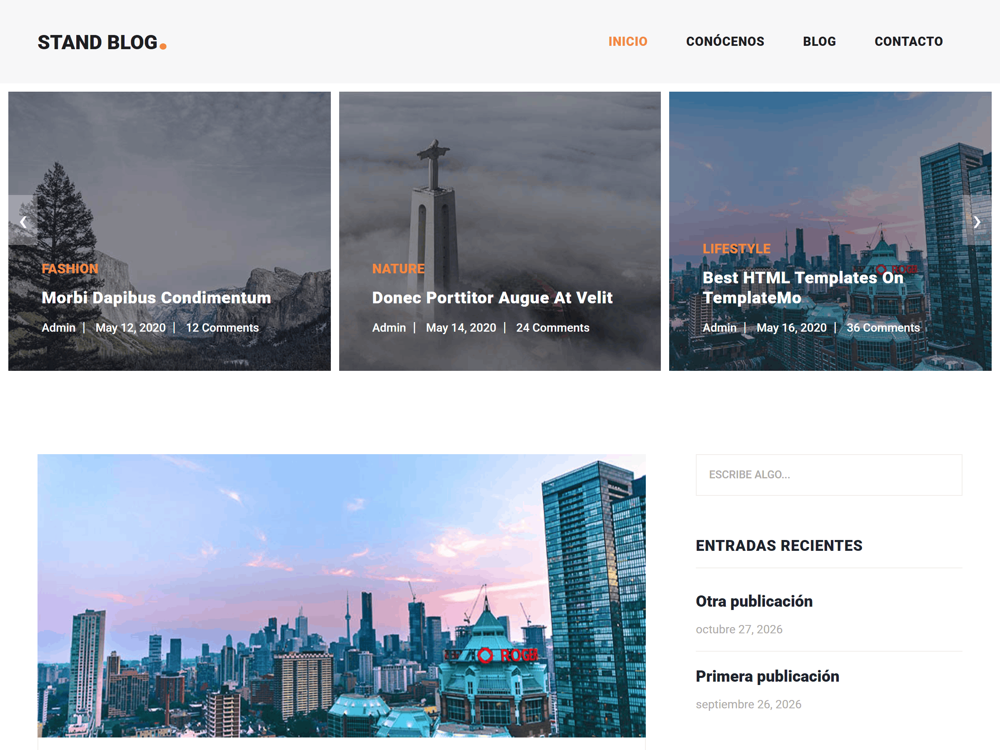

# Stand Blog – Tema WordPress

Tema de WordPress para blogs, creado a partir de la plantilla HTML **Stand Blog** de TemplateMo y convertido en un tema totalmente dinámico y personalizable: menús, sidebar con widgets, paginación, comentarios, página de contacto y un bloque de Gutenberg propio.

> Créditos de la plantilla HTML original: [TemplateMo – Stand Blog (tm-551)](https://templatemo.com/tm-551-stand-blog)



## Características

- Conversión completa de HTML estático a plantillas PHP de WordPress (`front-page`, `home`, `single`, `page`, `page-contact`, `comments`, `searchform`).
- Partes reutilizables en `template-parts/`.
- Menú principal registrado (`menu-principal`) con clases de Bootstrap (`nav-item`, `nav-link`, `active`) inyectadas por filtros.
- Sidebar principal con soporte de widgets clásicos, envueltos con el marcado de la plantilla.
- Paginación con marcado personalizado (`<ul>` / `<li>`) compatible con los estilos del tema.
- Soporte de imagen destacada y `title-tag`.
- Campos personalizados definidos en `inc/custom-fields.php`.
- Bloque de Gutenberg propio (`hmtm-info-grid`) desarrollado con `@wordpress/scripts`.
- Assets locales: Bootstrap, jQuery, Owl Carousel, Slick, Isotope, Flex Slider y Font Awesome.

## Estructura

```
├── assets/            # CSS, JS e imágenes de la plantilla
├── inc/               # Funcionalidades extra (campos personalizados)
├── src/blocks/        # Código fuente de los bloques de Gutenberg
├── template-parts/    # Fragmentos reutilizables de plantilla
├── vendor/            # Librerías front-end (Bootstrap, jQuery)
├── functions.php      # Registro de estilos, scripts, menús, sidebar y bloques
├── front-page.php
├── home.php
├── single.php
├── page.php
├── page-contact.php
├── comments.php
├── searchform.php
└── style.css          # Cabecera del tema
```

## Requisitos

- WordPress 6.x
- PHP 7.4 o superior
- Node.js y npm (solo para compilar los bloques)

## Instalación

1. Clona el repositorio dentro de `wp-content/themes/`:

   ```bash
   cd wp-content/themes
   git clone https://github.com/Homer1020/wordpress-blog-theme.git
   ```

2. Instala las dependencias y compila los bloques:

   ```bash
   cd wordpress-blog-theme
   npm install
   npm run build
   ```

3. Activa el tema desde **Apariencia → Temas**.

## Configuración

1. **Menú:** crea un menú en **Apariencia → Menús** y asígnalo a la ubicación *Menú Principal*.
2. **Sidebar:** agrega widgets en **Apariencia → Widgets** dentro de *Sidebar principal*.
3. **Página de inicio y blog:** en **Ajustes → Lectura**, define la página de inicio y la página de entradas.
4. **Contacto:** crea una página con el slug `contact` para que use la plantilla `page-contact.php`.

## Desarrollo

```bash
npm start       # compila los bloques en modo watch
npm run build   # compilación para producción
```

Para registrar un nuevo bloque, créalo en `src/blocks/<nombre>` y regístralo en `functions.php`:

```php
register_block_type( get_template_directory() . '/build/blocks/<nombre>' );
```

## Tecnologías

PHP · WordPress · Gutenberg (`@wordpress/scripts`) · Bootstrap · jQuery · HTML · CSS

## Créditos

- Plantilla HTML original: [TemplateMo – Stand Blog](https://templatemo.com/tm-551-stand-blog)
- Conversión a tema de WordPress: [Homer1020](https://github.com/Homer1020)
